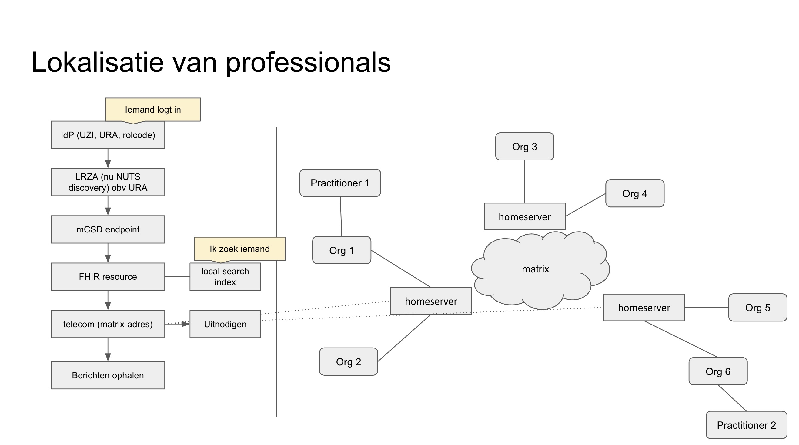

## 🏗️ Toepassing instante communicatie

**Versie: 0.2.2**

### Changelog

| Versie | Datum | Wijziging |
| --- | --- | --- |
| 0.2.2 | 2026-09-04 | Sectie 7 bijgewerkt naar de actuele richting van GF Adressering: centraal LRZa zonder persoonsgegevens, per zorgorganisatie een Endpoint naar het eigen mCSD endpoint met de zorgverleners en hun Matrix-adressen; infobox dat GF Adressering nog in ontwikkeling is |
| 0.2.1 | 2026-09-04 | Notitie toegevoegd dat de GF Pseudonimisering (PRS) wordt herontworpen; sectie Pseudonimisering/PRS en de pseudo-BSN in de invite-context gemarkeerd als te herzien |
| 0.2.0 | 2026-02-10 | UC9 toegevoegd: Gebruiker Verwijderen (kick uit Room/Space) |
| 0.1.0 | 2025-06-20 | Initiële versie specificatie |

---
### Copyright


This document is released under the [Attribution-ShareAlike 4.0 International (CC BY-SA 4.0) license](https://creativecommons.org/licenses/by-sa/4.0/).
---

### **1. Doelstelling**

Het vaststellen van **matrix.org** als een veilig, gefedereerd communicatieprotocol voor zorgsystemen om gestandaardiseerde instant messaging, zorgcoördinatie en teamgerichte workflows mogelijk te maken—afgestemd op zorgdatastandaarden en identiteitsbeheer.

---

### **2. Use Cases**

Gebaseerd op real-world vereisten van zorgplatforms, demonstreren de volgende use cases de praktische toepassing van Matrix voor zorgcommunicatie:

#### 📋 UC1: Netwerkbeheer
**Zorgnetwerk Ophalen**
- Alle deelnemers in het zorgnetwerk van een cliënt ophalen
- Per deelnemer weergeven: naam, functie/relatie en afwezigheidsperiodes indien van toepassing
- Ondersteuning voor zowel lokale als gefedereerde netwerkontdekking via mCSD

#### 💬 UC2: Nieuwe Gesprekken Starten
**Nieuwe Berichtthread Aanmaken**
- Verplichte velden: onderwerp (max 50 tekens), berichtinhoud (onbeperkt), ontvangers, verzender
- Optioneel: tot 5 bijlagen per bericht
- Automatische cliëntassociatie via Matrix space membership
- Ontvangers geselecteerd uit zorgnetwerk deelnemers

#### 📝 UC3: Berichtenbeheer
**Berichten Weergeven en Beheren**
- Berichtenlijst ophalen voor specifieke cliënt
- Per bericht weergeven: ID, onderwerp, status (gearchiveerd/actief), deelnemers
- Specifieke berichten bekijken met alle reacties, bijlagen en deelnemersrollen
- Op toestemming gebaseerde verwijderrechten ("allow_destroy" per reactie/bijlage)

#### 🔄 UC4: Cross-Platform Integratie
**Bestaande Netwerk Migratie**
- Zorgaanbieder wisselt van platform (bijv. van propriëtair systeem naar Matrix)
- Bestaande zorgnetwerken moeten behouden blijven bij platformwisseling
- Professionals verhuizen naar nieuwe systemen met behoud van zorgcontexten
- Automatische homeserver migratie met room her-uitnodigingen

#### 🏥 UC5: Multi-Organisatie Samenwerking
**Inter-Organisatorische Communicatie**
- Apotheken, huisartsen en specialisten die samenwerken aan cliëntzorg
- Elke organisatie behoudt eigen homeserver en identiteitsbeheer
- Gefedereerde ontdekking via mCSD voor het vinden van zorgverleners tussen organisaties
- Naadloze communicatie ondanks verschillende onderliggende zorgsystemen

#### 👨‍⚕️ UC6: Professionele vs. Cliëntcommunicatie
**Selectieve Deelname**
- Alleen-professionele discussies (medicatiereview, zorgplanning)
- Cliënt/familie inclusieve gesprekken (zorgupdates, educatieve inhoud)
- Power level beheer zorgt voor juiste toegangsrechten
- Cliëntaanwezigheid in rooms is configureerbaar per gesprekstype

#### 📱 UC7: Multi-Modale Toegang
**Platform-Agnostische Toegang**
- Webinterfaces voor uitgebreide workflow integratie
- Mobiele apps voor onderweg communicatie
- Push notificaties voor urgente berichten
- Offline bericht queueing en synchronisatie

#### 🔐 UC8: Compliance en Audit
**Zorgregulatie Compliance**
- Berichtretentiebeleid afgestemd op bewaarintermijnen van zorgdossiers
- Audittrails voor alle communicaties
- Privacy controles voor gevoelige discussies
- Integratie met bestaande zorginformatiesystemen voor archivering

#### 🚪 UC9: Gebruiker Verwijderen
**Deelnemer Verwijderen uit Gesprek of Zorgnetwerk**

Er zijn twee niveaus van verwijdering, overeenkomend met de Matrix Space/Room hiërarchie:

**Verwijderen uit een Gesprek (Room-level kick):**
- Zorgverlener (power level 75+) kan een deelnemer verwijderen uit een specifiek gesprek
- Matrix: `m.room.member` event met `membership: "leave"` wordt verstuurd, inclusief verplichte `reason`
- FHIR: De gebruiker wordt verwijderd uit `CommunicationRequest.recipient`
- De gebruiker blijft lid van het CareTeam (Space) en kan opnieuw worden uitgenodigd voor het gesprek

**Verwijderen uit een CareTeam (Space-level kick):**
- Alleen de Care Team Lead / Hoofdbehandelaar (power level 100) kan een deelnemer uit het CareTeam verwijderen
- Matrix: `m.room.member` event met `membership: "leave"` op de Space, gevolgd door een cascade naar alle child rooms waar de gebruiker lid van is
- FHIR: De gebruiker wordt verwijderd uit `CareTeam.participant` (of `period.end` wordt gezet voor audittrail)
- FHIR: De gebruiker wordt verwijderd uit `CommunicationRequest.recipient` voor elk gesprek waar de gebruiker in deelnam
- De cascade naar child rooms wordt niet automatisch door Matrix uitgevoerd; dit is een verantwoordelijkheid van de applicatielaag

**Algemeen:**
- Verwijdering vereist een reden (`reason` veld) ten behoeve van de audittrail (zie UC8)
- Verwijderde gebruikers kunnen opnieuw worden uitgenodigd (kick, geen ban)
- Bij cross-organisatie verwijdering wordt het leave-event via Matrix federation gepropageerd naar de remote homeserver
- `PractitionerRole.active` wordt niet aangepast; dit is een globale status die losstaat van CareTeam-membership

---

### **3. Identiteit & Authenticatie Integratie**

#### ✅ Identiteit Mapping

- **Matrix User IDs** moeten gekoppeld worden aan bestaande zorgidentiteiten:
  - **Zorgverleners**: Gebruik OIDC authenticatie via Identity Provider (IdP) van zorgaanbieder. mCSD wordt gebruikt om de mogelijke Matrix account van de Zorgverlener te lokaliseren op basis van hun identiteit in het zorgsysteem. Het UZI-nummer, URA-nummer en rolcode(s) worden gebruikt als 3PIDs voor identificatie.
  - **RelatedPersons (bijv. mantelzorgers)**: Gebruik email + wachtwoord + 2FA via zorgplatform. Het email-adres wordt gebruikt als 3PID voor identificatie.
  - **Cliënten**: Optioneel onboarded; kunnen lokale Matrix accounts hebben gebaseerd op email. Het email-adres wordt gebruikt als 3PID voor identificatie.

#### 🔄 3PID Identificatie voor Zorgverleners

Voor zorgverleners (Practitioners) is het essentieel dat vanuit hun Matrix ID de bijbehorende mCSD FHIR resource URL kan worden achterhaald. Dit is nodig om het CareTeam correct te kunnen vullen met de juiste FHIR resource referenties voor implementaties die met FHIR werken.

Zorgverleners worden daarom in Matrix geïdentificeerd met zowel hun Matrix ID als hun UZI-nummer, URA-nummer en rolcode als 3PIDs (Third-Party IDs):

- **Reverse-lookup functionaliteit**: Het ontvangende systeem moet de zorgidentiteit van de Practitioner kunnen terugzoeken om de mCSD FHIR resource URL te vinden
- **FHIR resource koppeling**: De UZI, URA en rolcode worden toegevoegd als 3PIDs in het Matrix gebruikersprofiel, waardoor de bijbehorende Practitioner of PractitionerRole resource URL kan worden achterhaald
- **Consistente identiteit**: Het 3PID mechanisme zorgt voor een betrouwbare koppeling tussen Matrix-identiteit en zorgsysteemidentiteit
- **Cross-systeem interoperabiliteit**: Deze aanpak garandeert dat de identiteit consistent blijft tussen verschillende zorgsystemen

**Identificatie-elementen:**
- **UZI-nummer**: Persoonlijke identifier voor de zorgverlener
- **URA-nummer**: Identificeert de zorgorganisatie waar de zorgverlener werkzaam is
- **Rolcode**: Geeft aan welke (beroeps-)rol de zorgverlener vervult bij de zorgaanbieder (conform FHIR PractitionerRole)

Een zorgverlener kan meerdere rollen hebben bij dezelfde of verschillende organisaties, wat resulteert in meerdere PractitionerRole resources en bijbehorende 3PID combinaties.

**Voorbeeld van 3PID toevoeging:**
```json
{
  "threepids": [
    {
      "medium": "uzi_nr",
      "address": "123456789",
      "validated_at": 1674123456789
    },
    {
      "medium": "ura_nr",
      "address": "00000001",
      "validated_at": 1674123456789
    },
    {
      "medium": "role_code",
      "address": "158965000",
      "validated_at": 1674123456789
    },
    {
      "medium": "email",
      "address": "dr.janssen@hospital-a.nl",
      "validated_at": 1674123456789
    }
  ]
}
```

Deze methode zorgt voor een betere interoperabiliteit en vertrouwen tussen verschillende zorgsystemen die via Matrix communiceren, waarbij gebruik wordt gemaakt van de gestandaardiseerde zorgsector identifiers inclusief de specifieke rol die de zorgverlener vervult.

#### 🏠 Homeserver Toewijzing

- Voor **Zorgverleners**: Homeserver toewijzing is niet vastgepind aan oorsprong:
  - Zorgaanbieders kiezen welke serviceprovider hun homeserver host
  - Het homeserver adres wordt gepubliceerd door de Generieke Functie Adressering via mCSD endpoint
  - Dit zorgt voor flexibiliteit wanneer zorgaanbieders van leverancier wisselen

- Voor **RelatedPersons** (bijv. mantelzorgers) en **Cliënten**:
  - Gebonden aan het platform van oorsprong (het zorgplatform dat hen onboard)

#### ✅ IdentityServer API

- Implementeer een **Matrix IdentityServer** die ondersteunt:
  - Voor **Zorgverleners**: Na succesvolle authenticatie is het UZI-nummer en URA-nummer, en mogelijk de rolcode bekend. Op basis van het URA-nummer wordt opgezocht wat het mCSD adres van de zorgaanbieder is:
    1. Zoek op waar de mCSD van het URA-nummer staat (nu is dat met NUTS discovery)
    2. Als de gebruiker bij een ander mCSD staat:
      - Zoek de resource op in dat externe mCSD
      - Als die daar geen matrix-id heeft stopt het proces daar
      - Als die wel bestaat, gebruik die gevonden matrix-id
    3. Als de mCSD omgeving de eigen is:
      - Kijk in de eigen mCSD database of deze al een matrix-account heeft
      - Zo niet, maak dan een matrix-id aan met als 3PID de UZI, URA en eventueel rolcode
  - Voor **RelatedPersons** (bijv. mantelzorgers) en **Cliënten** worden identiteiten verschaft door het zorgplatform.
  - Een enkele IdentityServer per homeserver (vereist door Matrix spec).

---

### **4. Communicatiemodel: Rooms, Threads & Care Teams**

#### 🧠 Kernontwerp

- **Matrix Space = Care Team**

  - Elke space vertegenwoordigt een care team geassocieerd met een specifieke cliënt.
  - Membership omvat professionals en gerelateerde personen betrokken bij die cliënt's zorg.

- **Matrix Room = Gesprek**

  - Elke room modelleert een gesprek binnen het care team.
  - Mogelijkheden voor gestructureerde, gerichte gesprekken met verzender/ontvanger logica.

#### 🔐 Power Levels & Toestemmingen
De space representeert het het care team, alle personen betrokken bij een client. Binnen de space kunnen rooms worden aangemaakt, deze representeren specifieke gesprekken met een subset van de leden van de space.
Matrix spaces gebruiken een power level systeem (0-100) om toestemmingen te beheren. Voor zorgcommunicatie stellen we de volgende power level mapping voor:

**Power Level Structuur:**
- **100 (Administrator)**: Care Team Lead/Hoofdbehandelaar
  - Kan een space aanmaken, verwijderen en aanpassen
  - Kan elke gebruiker uitnodigen/verwijderen voor de space
  - Kan space instellingen en power levels wijzigen

- **75 (Zorgverlener)**: Erkende Zorgprofessionals
  - Kan andere gebruikers uitnodigen voor de space
  - Kan conversaties starten door een child room in de space aan te maken
  - Kan alle leden in de space uitnodigen voor een room waar hij in deelneemt.
  - Kan reageren op berichten en nieuwe berichten plaatsen in de room waarin de zorgverlener deelneemt

- **50 (Gerelateerde Persoon)**: Mantelzorgers, case managers
  - Kan geen andere gebruikers uitnodigen voor de space
  - Kan conversaties starten door een child room in de space aan te maken
  - Kan alle leden in de space uitnodigen voor een room die hij aanmaakt.
  - Kan reageren op berichten en nieuwe berichten plaatsen in de room waarin de gerelateerde persoon deelneemt

- **25 (Cliënt)**: Wanneer cliënten direct deelnemen
  - Kan geen andere gebruikers uitnodigen voor de space
  - Kan reageren op berichten en nieuwe berichten plaatsen in de room waarin de client deelneemt

**Space-Level Toestemming Matrix (Care Team):**
```json
 {
  "events": {
    "m.space.name": 100,
    "m.space.topic": 100,
    "m.room.member": 75,
    "m.space.child": 50
  },
  "events_default": 100,
  "invite": 75,
  "kick": 100,
  "ban": 100,
  "redact": 100,
  "state_default": 100,
  "users_default": 25,
  "notifications": {
    "room": 75
  }
}
```

**Room-Level Toestemming Matrix Template (Gesprekken):**
```json
{
  "events": {
    "m.room.message": 25,
    "m.room.name": 75,
    "m.room.topic": 75,
    "m.room.member": 50,
    "m.reaction": 25
  },
  "events_default": 75,
  "invite": 50,
  "kick": 75,
  "ban": 100,
  "redact": 50,
  "state_default": 75,
  "users_default": 25,
  "notifications": {
    "room": 50
  }
}
```

**Rol-Gebaseerde Toewijzingsregels:**
- **Automatische toewijzing** gebaseerd op FHIR PractitionerRole codes
- **Dynamische aanpassing** wanneer care team samenstelling verandert
- **Audit trail** van power level wijzigingen voor compliance
- **Fallback toestemmingen** voor cross-organisatorische samenwerking

#### 🩺 Cliënt Associatie

- **Cliëntidentiteit wordt alleen gecommuniceerd in uitnodigingsberichten** bij het uitnodigen van gebruikers van andere homeservers, als je die via mCSD hebt verkregen (als de andere kant ook een zorginstelling is).
- **Room metadata bevat geen cliëntinformatie** om datalekkage te voorkomen. Matrixservers bevatten hiermee geen persoonsgegevens.
- Eenmaal uitgenodigd, is het ontvangende systeem verantwoordelijk voor het lokaal onderhouden van de cliënt-space associatie.
- Gebruik `m.space.child` en `m.space.parent` events om een top level space en child rooms voor elk gesprek aan te maken, zonder cliëntdata bloot te stellen in de metadata.
- **Uitnodigingscontext Uitbreiding:** Aan de content van uitnodigingsberichten is het `nl-ta-chat.invite.context` veld toegevoegd. Dit element bevat:
  - **version**: Een versienummer voor de contextstructuur (momenteel 1.0)
  - **room.subject**: Een FHIR resource van het subject van de room, waarin de cliëntidentificatie wordt meegegeven  Het `room.subject` veld bevat een FHIR resource (bijvoorbeeld een Patient resource) waarmee het ontvangende systeem de uitnodiging kan associëren met de juiste cliënt in hun eigen systeem. Dit zorgt ervoor dat zorgverleners van verschillende organisaties context hebben over welke cliënt het betreft wanneer ze worden uitgenodigd voor een care team discussie.
  - n.b. In deze versie is er bewust voor gekozen de *reden* of *aandoening* niet aan de context toe te voegen. Mogelijk in use-cases rond Shared Care Planning is een dergelijk veld van toepassing.

**Voorbeeld Matrix Invite Event (Standaard JSON):**
```json
{
  "type": "m.room.member",
  "state_key": "@practitioner:hospital-b.nl",
  "content": {
    "membership": "invite",
    "reason": "Invited to care team for patient consultation",
    "nl-ta-chat.invite.context": {
      "version" : 1.0,
      "room.subject": {
        "resourceType" : "Patient",
        "identifier" : [{
          "value": "87479412034",
          "system": "http://fhir.nl/fhir/NamingSystem/pseudo-bsn"
        }]
      }
    }
  },
  "sender": "@nurse:hospital-a.nl",
  "origin_server_ts": 1674123456789,
  "event_id": "$example_event_id"
}
```


Deze aanpak zorgt ervoor dat cliëntdata alleen wordt blootgesteld tijdens het uitnodigingsproces en niet persistent wordt in room state.

##### Pseudonimisering/PRS

> **Let op: de PRS wordt herontworpen.** De Generieke Functie Pseudonimisering wordt door VWS opnieuw ontworpen. Zie de concept-implementatiegids [Pseudonymisation](https://minvws.github.io/generiekefuncties-docs/en/pseudonymisation.html) (status draft, versie 0.10.0, stand augustus 2026). Die gids beschrijft slechts een deel van de PRS-specificatie, namelijk het cryptografische mechanisme: een HKDF-afleiding van het BSN gescoped op de ontvanger, een OPRF met blinding, en één `evaluate`-transactie waarbij de PRS zelf geen BSN of pseudoniem ziet of bewaart. Onderwerpen als sleutelrotatie, beheer, aansluitvoorwaarden en de volledige referentieflow zijn daar nog niet in uitgewerkt.
>
> In het nieuwe ontwerp bestaat er geen operatie meer om een pseudoniem-token om te wisselen voor het BSN. Het hieronder beschreven proces (met name stap 3 tot en met 6) gaat daar wel van uit en zal in deze vorm niet blijven bestaan. Deze sectie, de invite-context (`room.subject` met pseudo-BSN) en het Patient-voorbeeld in sectie 7 worden herzien zodra het PRS-ontwerp definitief is. Implementaties moeten er rekening mee houden dat dit deel van de specificatie gaat wijzigen.

Voor pseudonimisering gebruiken we de generieke functie Pseudoniemen Referentie Service (PRS). Het proces voor de PRS werkt als volgt:

1. Je bent aangesloten op de PRS (zowel technisch als juridisch) en mag BSN verwerken
2. Jij hebt een BSN van de persoon
3. Je stuurt een verzoek naar de PRS om voor dat BSN van de persoon + de ontvangende partij (zoals ontdekt vanuit mCSD) een eenmalig pseudoniem-token te ontvangen
4. Je voegt dat eenmalige pseudoniem-token (scoped op de ontvanger) toe aan de invite, zoals hierboven met het juiste identifier system.
5. De ontvanger ontvangt de invite en is ook aangesloten op de PRS (technisch & juridisch)
6. De ontvanger wisselt het eenmalige pseudoniem-token om bij de PRS om de BSN weer te ontvangen
7. De ontvanger slaat de associatie BSN en CareTeam/Matrix Space op in haar database.

#### 🔧 Custom State Events

Naast de standaard Matrix events worden er custom state events gebruikt voor specifieke zorgfunctionaliteit:

**1. User Mappings State Event (`custom.user_mappings`)**
- **Doel**: Opslaan van FHIR identiteit mappings per gebruiker
- **State key**: Matrix user ID (bijv. `@user:homeserver.nl`)
- Let op! Deze FHIR identiteit mappings mogen geen persoonsgegevens zijn (dus geen BSN).
- **Content structure**:
```json
{
  "fhirRef": "Patient/123 | Practitioner/456 | RelatedPerson/789",
  "uraNr": "00000001",
  "uziNr": "123456789",
  "roleCode": "158965000",
  "email": "user@example.com"
}
```
- **Gebruik**: Wordt toegevoegd aan zowel spaces (care teams) als rooms (gesprekken) om gebruikers te koppelen aan hun FHIR identiteit

**2. Space Relationship Events**
Voor het beheren van hiërarchische relaties tussen spaces en rooms:

- **Space Parent Event (`m.space.parent`)**
  - **State key**: Space ID
  - **Content**: `{"via": ["homeserver.nl"], "canonical": true}`
  - **Gebruik**: Geplaatst in room om aan te geven dat de room onderdeel is van een space

- **Space Child Event (`m.space.child`)**
  - **State key**: Room ID
  - **Content**: `{"via": ["homeserver.nl"], "order": "01", "suggested": true}`
  - **Gebruik**: Geplaatst in space om aan te geven dat een room een child is van de space

Deze events zorgen voor bidirectionele space-room relaties en ondersteunen de care team structuur.

---

### **5. Messagingmodel**

#### 🧭 Adressering

- Alle berichten ondersteunen adressering via Matrix mentions en rollen.
- Optioneel: Gebruik room tags of labels om urgentie, onderwerpen of domeinen te markeren (bijv. medicatie, wonen, psychosociaal).
- Generieke Functie Adressering vormt het onderliggende mechanisme voor het lokaliseren van Zorgverleners.

#### Minimale implementatie

Indien je een bridge of de Matrix Client SDK implementeert (ipv de normale web client te gebruiken), implementeer dan minimaal:

- Normale berichten zonder opmaak of emoji
- Berichten met basisopmaak (bold, italic, underline)
- Berichten met basisemoji of andere Unicode tekens

Het implementeren van custom emoji, video, afbeeldingen etc is optioneel. Als er een bericht ontvangen wordt met deze inhoud dan moet je een bericht terugsturen naar de verzender dat dit type bericht niet wordt ondersteund (bijv vanuit de bot zelf) en geef je het bericht vanaf de SDK of bridge door met een foutmelding aan de gebruiker, zodat deze op de hoogte is dat er inhoud is verdwenen.

---

### **6. Onboarding, Uitnodigingen & Verwijdering**

#### 📨 Gebruiker Uitnodigingsmethoden

**Zorgverleners:**
Zorgverleners loggen in met de IdP van hun zorgorganisatie. Na succesvolle authenticatie is het UZI-nummer en URA-nummer, en mogelijk de rolcode bekend. Op het moment dat ze willen gaan communiceren met de matrix omgeving, wordt de volgende logica uitgevoerd om ze te onboarden:

1. Op basis van het URA-nummer wordt opgezocht wat het mCSD adres van de zorgaanbieder is
2. Wordt bepaald of de mCSD van de zorgaanbieder wordt beheerd door de huidige leverancier
3. Afhankelijk van wie de mCSD beheert:
  - Indien de mCSD niet door de huidige leverancier wordt beheerd:
    - Wordt door middel van mCSD de zorgverlener opgezocht
    - Indien de account niet bestaat, kan de zorgverlener enkel naar de omgeving van de zorgaanbieder worden verwezen om een matrix identiteit te krijgen
  - Indien de mCSD door de huidige leverancier wordt beheerd kan automatisch een account worden aangemaakt

*Vooralsnog gaan we er van uit dat de mCSD door dezelfde leverancier wordt geleverd als de homeserver.*

**RelatedPersons en Cliënten:**
RelatedPersons en cliënten ontvangen email uitnodigingen.

**PGO gebruikers (MedMij)**
PGO gebruikers gebruiken een nog te ontwikkelen Gegevensdienst om de beschikbare chats bij een DVA (een deelnemer aan deze specificatie) op te halen. Daarna stuurt het PGO een Matrix ID naar de DVA. De DVA voegt die gebruiker via een normale invite toe aan de bestaande Room & Space.

#### 🚪 Gebruiker Verwijderen

Verwijdering van gebruikers maakt gebruik van de Matrix kick-functionaliteit (`m.room.member` event met `membership: "leave"`). Er zijn twee niveaus van verwijdering:

**Verwijderen uit een Gesprek (Room-level):**

Een zorgverlener (power level 75+) kan een deelnemer uit een gesprek verwijderen:

1. De zorgverlener stuurt een kick-event op de Room met een verplichte `reason`
2. De applicatie werkt de bijbehorende `CommunicationRequest.recipient` bij
3. De gebruiker blijft lid van het CareTeam (Space) en kan opnieuw worden uitgenodigd

**Verwijderen uit een CareTeam (Space-level):**

Alleen de Care Team Lead / Hoofdbehandelaar (power level 100) kan een deelnemer uit het CareTeam verwijderen:

1. De hoofdbehandelaar stuurt een kick-event op de Space met een verplichte `reason`
2. De applicatie doorloopt alle child rooms van de Space en kickt de gebruiker uit elke room waar deze lid van is (cascade). Matrix voert deze cascade **niet** automatisch uit; dit is een verantwoordelijkheid van de applicatielaag
3. De applicatie verwijdert de gebruiker uit `CareTeam.participant` (of zet `period.end` voor audittrail)
4. De applicatie werkt `CommunicationRequest.recipient` bij voor elk gesprek waar de gebruiker uit is verwijderd

**Berichthistorie:**
- De verwijderde gebruiker behoudt toegang tot de berichthistorie tot het moment van verwijdering (standaard Matrix-gedrag)
- Nieuwe berichten na de kick zijn niet zichtbaar voor de verwijderde gebruiker

**Her-uitnodiging:**
- Kick (in tegenstelling tot ban) staat her-uitnodiging toe
- Het standaard uitnodigingsproces (zie hierboven) wordt opnieuw gevolgd
- Bij her-uitnodiging in een Space worden de bijbehorende FHIR resources opnieuw aangemaakt (`CareTeam.participant`)

**Cross-organisatie verwijdering:**
- Het leave-event wordt via Matrix federation gepropageerd naar de remote homeserver
- Het ontvangende systeem is verantwoordelijk voor het bijwerken van de lokale cliënt-space associatie en FHIR resources

---

### **7. Directory & Service Discovery: Generieke Functie Adressering en Homeserver Lokalisatie**




#### 🔎 Generieke Functie Adressering via LRZa

> **Let op: de Generieke Functie Adressering en het LRZa zijn in ontwikkeling.** De specificaties van GF Adressering (functioneel ontwerp, technisch ontwerp en implementatiegids) worden in de Design Authority van VWS nog regelmatig aangepast en worden daarna eerst beproefd. Deze sectie beschrijft de richting zoals die in september 2026 bekend is en wordt bijgewerkt zodra de implementatiegids definitief is. Zie de concept-implementatiegids [Care Services Directory](https://minvws.github.io/generiekefuncties-docs/en/care-services.html).

**Generieke Functie Adressering** biedt het framework voor de lokalisatie van de homeserver en van zorgverleners:
  - Het LRZa (Landelijk Register Zorgaanbieders) is een centraal register van zorgaanbieders met hun diensten, locaties en endpoints. Afnemers werken met een lokale replica van het LRZa.
  - Het LRZa verwerkt geen persoonsgegevens. Zorgverleners (Practitioner en PractitionerRole) staan daarom niet in het LRZa.
  - Het LRZa bevat per zorgorganisatie een Endpoint dat verwijst naar het mCSD endpoint van die organisatie. Dat mCSD endpoint bevat de PractitionerRoles en Practitioners van de organisatie en functioneert als haar adresboek.
  - Op basis van het URA-nummer wordt in het LRZa het mCSD endpoint van de zorgorganisatie opgezocht; daarna wordt in dat mCSD endpoint de zorgverlener opgezocht.

Vooralsnog is het LRZa nog niet in staat deze gegevens te verwerken, daarom wordt NUTS-discovery ingezet om het mCSD endpoint op basis van het URA vast te stellen.

#### 📖 Matrix User Discovery via mCSD

- **FHIR mCSD Resource Gebruik**:
  - Het mCSD endpoint van de zorgorganisatie bevat de adresseringsgegevens van haar zorgverleners, inclusief hun Matrix-adressen. Deze gegevens staan niet in het LRZa.
  - Matrix adressen worden opgeslagen in de telecom array van Practitioner, Patient en RelatedPerson resources.
  - Applicaties gebruiken mCSD om zorgverleners en services op te zoeken op functie of locatie.
  - Tijdens identificatie en onboarding worden het UZI-nummer, URA-nummer en rolcode(s) als 3PIDs aan het Matrix-gebruikersaccount gekoppeld.

**Belangrijke FHIR Resources voor mCSD Integratie:**

  1. **Organization** - Zorgaanbieder organisaties
```json
   {
     "resourceType": "Organization",
     "id": "07d91b7d-eb06-47ef-b077-28e0d274c161",
     "name": "Hospital A",
     "type": [{"coding": [{"system": "http://terminology.hl7.org/CodeSystem/organization-type", "code": "prov"}]}],
     "contact": [
       {
         "purpose": {
           "coding": [
             {
               "system": "http://terminology.hl7.org/CodeSystem/contactentity-type",
               "code": "ADMIN"
             }
           ]
         },
         "telecom": [
           {
             "system": "other",
             "value": "matrix.hospital-a.nl",
             "use": "work",
             "extension": [
               {
                 "url": "http://hl7.org/fhir/StructureDefinition/contactpoint-purpose",
                 "valueString": "matrix-homeserver"
               }
             ]
           }
         ]
       }
     ]
   }
```

2. **Practitioner** - Individuele zorgprofessionals
```json
   {
     "resourceType": "Practitioner",
     "id": "6a6b85e9-f7d8-4b62-8dc5-94f00b1d6594",
     "identifier": [{"system": "http://fhir.nl/fhir/NamingSystem/uzi-nr-pers", "value": "123456789"}],
     "name": [{"family": "Janssen", "given": ["Dr. H."]}],
     "telecom": [
       {
         "system": "email",
         "value": "dr.janssen@hospital-a.nl",
         "use": "work"
       },
       {
         "system": "other",
         "value": "@dr.janssen:matrix.hospital-a.nl",
         "use": "work",
         "extension": [
           {
             "url": "http://hl7.org/fhir/StructureDefinition/contactpoint-purpose",
             "valueString": "matrix-messaging"
           }
         ]
       }
     ]
   }
```

3. **PractitionerRole** - Koppelt zorgverleners aan organisaties met rollen
```json
   {
     "resourceType": "PractitionerRole",
     "id": "df54b889-d6f5-4d89-993f-2af7950ea83b",
     "practitioner": {"reference": "Practitioner/6a6b85e9-f7d8-4b62-8dc5-94f00b1d6594"},
     "organization": {"reference": "Organization/07d91b7d-eb06-47ef-b077-28e0d274c161"},
     "code": [{"coding": [{"system": "http://snomed.info/sct", "code": "158965000", "display": "Medical practitioner"}]}]
   }
```

4. **Patient** - Cliënten met optionele Matrix toegang
```json
   {
     "resourceType": "Patient",
     "id": "patient-123",
     "identifier": [{"system": "http://fhir.nl/fhir/NamingSystem/pseudo-bsn", "value": "87479412034"}],
     "name": [{"family": "De Vries", "given": ["Jan"]}],
     "telecom": [
       {
         "system": "email",
         "value": "jan.devries@example.com",
         "use": "home"
       },
       {
         "system": "other",
         "value": "@jan.devries:matrix.example.com",
         "use": "home",
         "extension": [
           {
             "url": "http://hl7.org/fhir/StructureDefinition/contactpoint-purpose",
             "valueString": "matrix-messaging"
           }
         ]
       }
     ]
   }
```

5. **RelatedPerson** - Mantelzorgers en familieleden
```json
   {
     "resourceType": "RelatedPerson",
     "id": "related-person-456",
     "patient": {"reference": "Patient/patient-123"},
     "relationship": [{"coding": [{"system": "http://terminology.hl7.org/CodeSystem/v3-RoleCode", "code": "CHILD"}]}],
     "name": [{"family": "De Vries", "given": ["Maria"]}],
     "telecom": [
       {
         "system": "email",
         "value": "maria.devries@example.com",
         "use": "home"
       },
       {
         "system": "other",
         "value": "@maria.devries:matrix.example.com",
         "use": "home",
         "extension": [
           {
             "url": "http://hl7.org/fhir/StructureDefinition/contactpoint-purpose",
             "valueString": "matrix-messaging"
           }
         ]
       }
     ]
   }
```

6. **HealthcareService** - Services aangeboden door organisaties
```json
   {
     "resourceType": "HealthcareService",
     "id": "83f74cda-a81b-4598-a9d0-bab02d387caf",
     "providedBy": {"reference": "Organization/07d91b7d-eb06-47ef-b077-28e0d274c161"},
     "category": [{"coding": [{"system": "http://terminology.hl7.org/CodeSystem/service-category", "code": "1"}]}]
   }
```

7. **Location** - Fysieke locaties waar services worden aangeboden
```json
   {
     "resourceType": "Location",
     "id": "351027f8-febc-4698-a6c7-2b3d3d456fab",
     "name": "Hospital A Main Building",
     "managingOrganization": {"reference": "Organization/07d91b7d-eb06-47ef-b077-28e0d274c161"}
   }
```

**ContactPoint Extensions voor Matrix:**

Voor het correct identificeren van Matrix-gerelateerde contactinformatie worden de volgende extension waarden gebruikt:

- **matrix-messaging**: Voor individuele Matrix user IDs (@gebruiker:homeserver.nl)
- **matrix-homeserver**: Voor homeserver adressen (homeserver.nl) op organisatie niveau

**Lookup Proces:**

1. **Directe gebruiker lookup**: Zoek in mCSD naar Practitioner/Patient/RelatedPerson resources met telecom entries die matrix-messaging extensions bevatten
2. **Homeserver identificatie**: Bepaal de homeserver via de Organization resource of extraheer uit de Matrix user ID
3. **Cross-referencing**: Gebruik UZI/URA nummers als 3PIDs voor identiteitsverificatie en reverse lookup
#### 🔄 Zorgverlener Lokalisatieproces

- **Netwerkcommunicatie Flow voor Zorgverleners**:
  1. Zorgverlener logt in via de IdP van hun zorgaanbieder
  2. Op basis van het URA-nummer van de zorgaanbieder wordt het mCSD endpoint bepaald
  3. Applicatie zoekt naar de zorgverlener in mCSD
  4. mCSD verschaft de homeserver en identiteitsinformatie
  5. Twee scenario's:
    - **Optie 1**: Homeserver behoort tot de huidige leverancier
      - Gebruikersdata is al gesynchroniseerd of kan worden opgehaald via standaard integratie (Application Service, aka AS)
    - **Optie 2**: Homeserver behoort tot een andere leverancier
      - Gebruikersdata moet worden opgevraagd tijdens de sessie via client-server API
  6. Bij nieuwe Practitioner accounts:
    - Configureer het UZI-nummer, URA-nummer en rolcode(s) als 3PIDs via de Matrix Identity Server API
    - Dit vergemakkelijkt reverse-lookup en identiteitsverificatie.

#### 📚 Data Model Uitbreidingen

- Implementeer mCSD/FHIR indexering voor:
  - `Organization`
  - `Practitioner`
  - `PractitionerRole`
  - `HealthcareService`
  - `Endpoint` (bevat Matrix homeserver details)

#### 🔁 Migratieprotocol

- **Wanneer zorgaanbieder van leverancier wisselt**:
  1. Zorgaanbieder publiceert nieuw mCSD endpoint bij andere leverancier, of updatet bestaande mCSD database met nieuwe homeserver adressen als Endpoints van de PractitionerRole
  2. Huidige leverancier observeert de wijziging en voor gebruikers die actief waren in hun homeserver maar nu elders toegewezen zijn:
    - Nodigt de nieuwe identiteit uit voor alle relevante rooms
    - Deactiveert het huidige account met Matrix [account deactivation API](https://spec.matrix.org/v1.14/client-server-api/#post_matrixclientv3accountdeactivate)
  3. 3PIDs (UZI-nummer, URA-nummer en rolcode) worden gebruikt om de identiteit te verifiëren tijdens de migratie, waarbij de combinatie van deze identifiers zorgt voor unieke identificatie van zorgverleners en hun specifieke rollen.

---

### **8. Technische Stack & Deployment**

#### ⚙️ Matrix Component Overzicht

- **Synapse** of een andere Matrix homeserver als kern.
- Custom **IdentityServer** voor zorgplatforms:
  - Generieke Functie Adressering en mCSD.
  - Authenticeer zorgverleners met een zorgaanbieder IdP.
    - Pas de beschreven logica toe voor het lokaliseren en onboarden.
  - Authenticeer de gebruikers met hun applicatie / platform account.
- Andere **gedeelde libraries**:
  - Bericht transformatie (bijv. Healthcare FHIR ↔ Matrix)

###### IdentityServer logica voor zorgverleners


## Openstaande punten die input nodig hebben
- [ ] Het verbindingstype van het endpoint (http://terminology.hl7.org/CodeSystem/endpoint-connection-type), moet een eigen waarde krijgen of op een bestaande waarde in de valueset gemapped worden:
```
"connectionType": {"system": "http://terminology.hl7.org/CodeSystem/endpoint-connection-type", "code": "hl7-fhir-rest"}
```
- [ ] **Herontwerp GF Pseudonimisering (PRS)**: de sectie Pseudonimisering/PRS, de pseudo-BSN in de invite-context en het Patient-voorbeeld in sectie 7 zijn gebaseerd op het oude PRS-model (omwisselbaar pseudoniem-token). Herzien zodra het nieuwe ontwerp (OPRF met blinding, zonder omwisseling naar BSN) definitief is; zie de notitie in de sectie Pseudonimisering/PRS.
